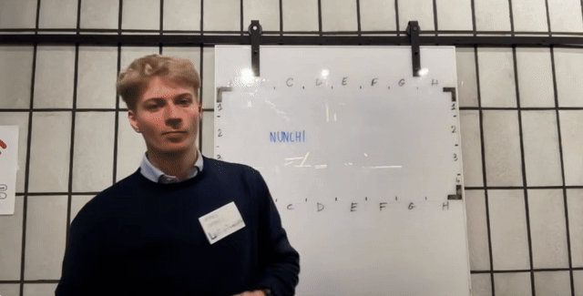
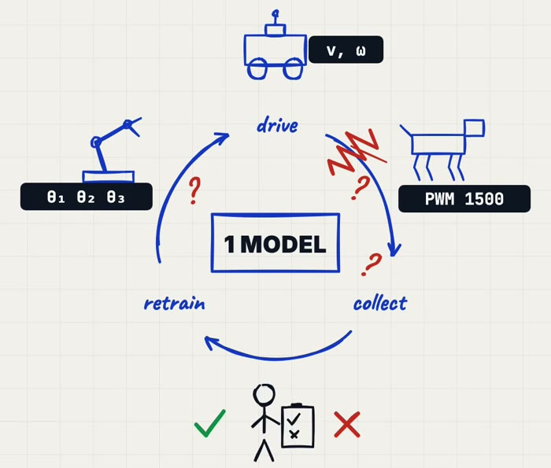
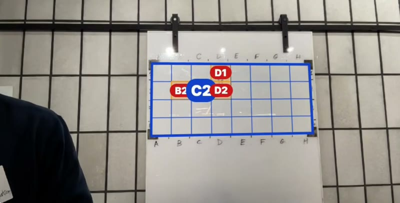
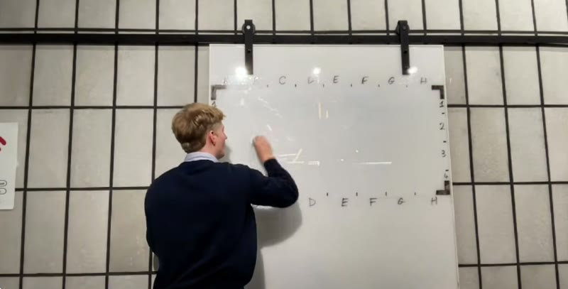
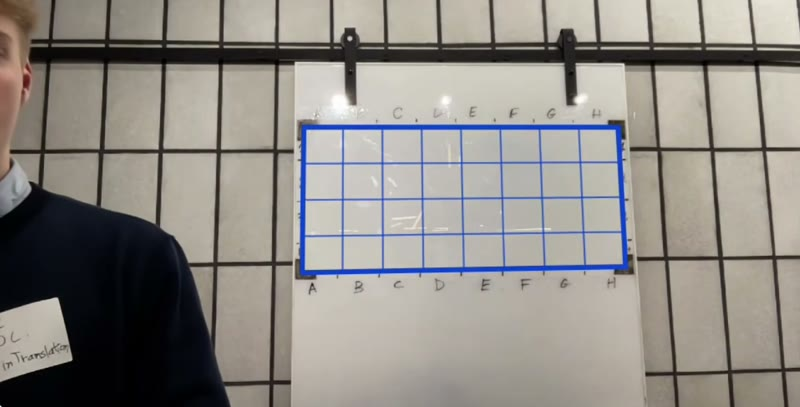
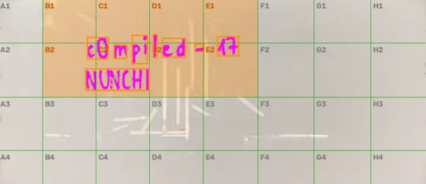
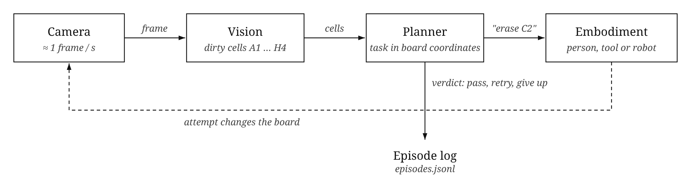

<div align="center">

<a href="https://luma.com/compiled-8lsr"></a>
&nbsp;&nbsp;&nbsp;&nbsp;
<a href="https://www.ycombinator.com/rfs"></a>

# NUNCHI

**The data flywheel for robots.**

A hackathon project from **c0mpiled-17 Seoul** (9 November 2026), on the Y Combinator Request for Startups topic<br/>*New Operating System for the Physical World*.

[](https://luma.com/compiled-8lsr)
[](https://www.ycombinator.com/rfs)
[](LICENSE)
[](#quick-start)
[](nunchi/analyze.py)
[](apps/nunchi/)



<sub>Camera view during the demo.</sub>

</div>

## The problem

Tesla gets better because its cars send driving data back, the model is retrained on it, and the new model drives the cars again. Robotics companies would like the same loop, a data flywheel, but two things get in the way.



First, each robot is commanded differently: joint angles for an arm, `v, ω` for a mobile base, PWM for a robot dog. A task written for one of them means nothing to the others.

Second, someone has to watch each attempt and write down whether it worked. Data only comes in as fast as people can label it.

We had five hours to show a way around both problems, so we picked a small task that a camera can check on its own: keeping a whiteboard clean. The name comes from the Korean word 눈치 (nunchi), roughly "knowing what is going on just by watching".

<br clear="right"/>

## What we built

A camera watches a glass whiteboard with an 8 × 4 grid drawn on it. Anything written in blue counts as dirt. When the camera sees ink in a cell, the planner creates a task for that cell, for example `erase C2`. The task is defined only by the cell's position on the board and a success threshold (less than 0.25 % of the cell still covered in ink), so it does not depend on who or what will do it.

The planner then phrases the task for whoever is available. A person hears a sentence, and a robot arm would get a motion command:

```text
task    erase C2          success: ink_ratio < 0.25%
human   "Marc, erase cell C2."
robot   arm.wipe(x=251..387mm, y=117..260mm, passes=3)
```

Nobody tells the system that the job is done. Once the person steps away, the next clear camera frame is compared with the threshold. If ink is left, the task is retried, possibly by someone else, up to three times. Each attempt is saved to `runs/<session>/episodes.jsonl` with who did it, the tool, the duration, crops of the cell before and after, and the result.

## Demo

We had no robot at the hackathon, so the two of us played the embodiments, one with an eraser and one with a tissue.

<table>
  <tr>
    <td width="33%" align="center" valign="top">
      
      <br/><sub>The camera finds ink in B2, C2, D1 and D2.</sub>
    </td>
    <td width="33%" align="center" valign="top">
      
      <br/><sub>Marc erases C2. Frames are ignored while he blocks the board.</sub>
    </td>
    <td width="33%" align="center" valign="top">
      
      <br/><sub>The next clear frame shows C2 clean.</sub>
    </td>
  </tr>
</table>

In this demo run, Marc needed three tries on C2. The log below was filled in by the system, not by us:

| Episode | Agent | Tool | Task | What the camera saw | Result |
|:-:|---|---|---|---|:-:|
| 1 | Marc | eraser | erase C2 | ink left | fail |
| 2 | Marc | eraser | erase C2 | ink left | fail |
| 3 | Marc | eraser | erase C2 | clean cell | pass |

## How it works

<div align="center">

<br/><sub>The board seen from above after rectification. Ink is boxed in pink and the dirty cells are shaded orange.</sub>
</div>
<br/>

The vision code is in [`nunchi/analyze.py`](nunchi/analyze.py). It treats every frame independently and takes about 30 ms for a 960 px frame on a laptop CPU, with no learned model.

1. It looks for the four black L-shaped tape marks at the corners of the board. If one is hidden, or the four marks do not form a plausible rectangle, the frame is dropped.
2. It warps the board to a top-down view using the four corners.
3. If a large dark area covers the board, someone is probably standing in front of it, and the frame is skipped.
4. Ink is any stroke darker than the board around it. We had to clip reflections from the ceiling lights and ignore specks under 40 px. Colour is checked per stroke, so the black tape, ticks and letters are not counted as dirt.
5. Each ink blob gets a bounding box, which is mapped onto the hand-drawn grid. The grid lines were measured once and saved in [`nunchi/grid.json`](nunchi/grid.json).

<p align="center"></p>

## Quick start

```bash
git clone https://github.com/promaaa/nunchi.git && cd nunchi
uv sync
uv run nunchi-standalone --agents Marc:eraser,Kangmin:tissue   # webcam, planner, voice, episode log
uv run pytest                                                  # tests on synthetic and real frames
```

<details>
<summary><b>Full stack with the phone app</b> (<a href="https://github.com/akan-team/akanjs">Akan.js</a> on Bun)</summary>

```bash
uv run nunchi                                                   # algorithm server, prints VISION_API_URL
bun install && VISION_API_URL=http://<host>:8000 bun run dev   # app server: Monitor and Eraser pages
```

After you redraw the grid ticks, measure them again from a clear photo: `uv run nunchi-grid photo.jpg`.

</details>

## Repository

| Path | Role |
|---|---|
| [`nunchi/`](nunchi/) | Vision: L marks, rectification, occlusion guard, ink, grid |
| [`nunchi/standalone/`](nunchi/standalone/) | All-in-one demo: task interface, planner, verifier, episode log |
| [`apps/nunchi/`](apps/nunchi/) | App server, Monitor and Eraser pages |
| [`docs/`](docs/) | [Algorithm server protocol](docs/protocol.md) and [standalone API](docs/standalone-api.md) |
| [`tests/`](tests/) | Protocol, standalone and real-frame tests |

## Team

- **Marc Duboc** ([@promaaa](https://github.com/promaaa)): vision, planner and verification.
- **Kangmin** ([@aka-bassman](https://github.com/aka-bassman)): app server, Monitor and Eraser pages.

We built this at [c0mpiled-17 Seoul](https://luma.com/compiled-8lsr), held at the COEX Startup Branch and organised by Transpose Platform. The topic came from the [Y Combinator Request for Startups](https://www.ycombinator.com/rfs).

## License

MIT. See [LICENSE](LICENSE).
