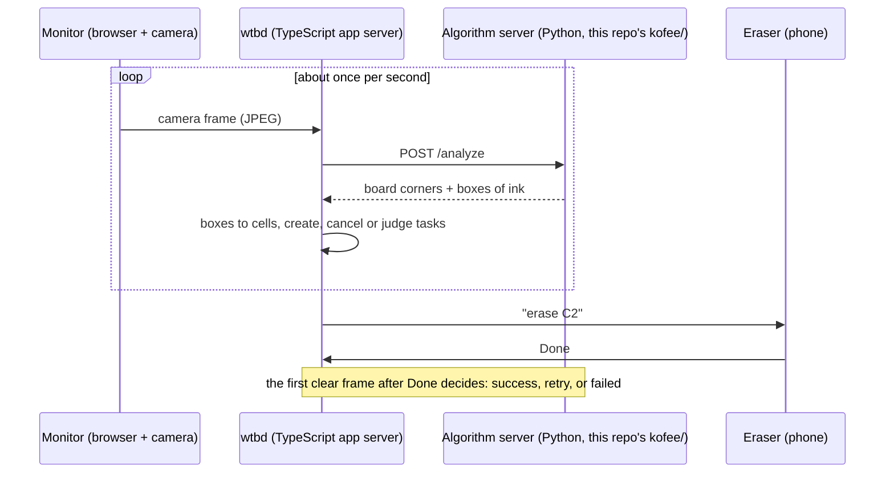

# kofee

**One task interface for any embodiment, and a camera that checks the result.**

Robot-learning data flywheels stall on two problems. Every robot speaks its own action language, so
tasks and data do not transfer across embodiments. And someone has to look at every attempt to say
whether it worked. kofee is a small, physical demo of both fixes, built at the Compiled 17 hackathon.

A whiteboard has to be kept clean. A camera watches it. Anything written in blue is dirt. The system
turns what it sees into tasks such as *"erase cell C2"*, expressed only in board coordinates, and
dispatches them to whoever is available. In the demo the robots are people with a phone, each one a
different embodiment with a different tool. Nobody tells the system whether a task succeeded: the
next camera frame does. Every attempt comes back labelled, which is exactly what a flywheel needs.

## The board

| Mark | Meaning |
| --- | --- |
| Four black **L tape marks** | The frame. Their inner elbows define board coordinates, found in every frame. |
| Black **ticks** along the edges | The 8 x 4 grid of cells (`A1` ... `H4`) that humans, phones and the server share. |
| **Blue** marker | Dirt to erase. Black ink is never dirt. |

## How it works



- **`apps/wtbd`**: the app server ([Akan.js](https://github.com/akan-team/akanjs) on Bun). It owns
  boards, cells and erase tasks, and serves the Monitor and Eraser pages.
- **`kofee/`**: the stateless algorithm server. One JPEG in, `{corners, regions}` out.
- **[`protocol/algorithm-server.md`](protocol/algorithm-server.md)**: the contract between the two.

## Run it

Algorithm server, on the machine that wtbd can reach:

```bash
uv sync
uv run kofee --grid grid.json      # prints the VISION_API_URL to give wtbd
```

App server, from the repo root:

```bash
bun install
VISION_API_URL=http://<algorithm-host>:8000 bun run dev
```

`grid.json` holds where the ticks really are on our board. wtbd lays a uniform grid over board space,
so the server reports boxes through a piecewise-linear map that makes wtbd's cells line up with the
ticks drawn by hand. After redrawing the ticks, measure them again from a clear photo:
`uv run kofee-grid photo.jpg`.

Tests: `uv run pytest`.

## The algorithm

Per frame, with no state carried between frames (`kofee/analyze.py`):

1. **Frame**: find the four L marks (`kofee/marks.py`). Grey blobs with the shape of an L, classified
   ┏ ┓ ┛ ┗ by which sides of their box they fill, then the most consistent quadrilateral. If a mark is
   hidden, the scan is unusable (`corners: null`): someone is in the way.
2. **Rectify** the frame to a top-down view of the board with the homography of the four elbows.
3. **Occlusion guard**: a large region far darker than the board is a person, an arm or an eraser.
   That scan is unusable too, so a task is never judged through someone's sweater.
4. **Ink** (`kofee/vision.py`): pixels darker than their local background and not orange, which
   rejects the reflections of the ceiling lights on the glass. Colour is then decided per stroke,
   because thin strokes lose their colour to the camera's chroma subsampling: averaged over a whole
   stroke, blue ink stays measurably blue while the black frame, ticks and labels stay neutral.
5. **Boxes**: one tight box per letter-sized blob, so ink never spills into a neighbouring cell.

It runs in about 30 ms per 960 px frame on a laptop CPU.

## Standalone mode

`uv run kofee-standalone` runs the whole loop in one process with no wtbd: webcam, planner, automatic
verification, spoken instructions, an episode log in `runs/`, and a dashboard with a 32 x 16 ink
heatmap. It is the fallback for the demo and the quickest way to tune the vision. Its HTTP API is
described in [`docs/standalone-api.md`](docs/standalone-api.md).

## Layout

| Path | Role |
| --- | --- |
| `apps/wtbd/` | App server, Monitor and Eraser pages (TypeScript) |
| `protocol/` | wtbd and algorithm server contract |
| `kofee/server.py` | Algorithm server: `POST /analyze`, `GET /health` |
| `kofee/analyze.py` | Frame to corners, occlusion check and ink boxes |
| `kofee/marks.py` | L-mark detection |
| `kofee/vision.py` | Ink detection and grids of ink ratios |
| `kofee/board.py` | Board geometry, rectification, tick detection |
| `kofee/grid.py` | `kofee-grid`: measure the ticks from a photo |
| `kofee/standalone/` | All-in-one fallback mode |
| `tests/` | Protocol and standalone tests on synthetic frames |

Team: [promaaa](https://github.com/promaaa) and [aka-bassman](https://github.com/aka-bassman).
