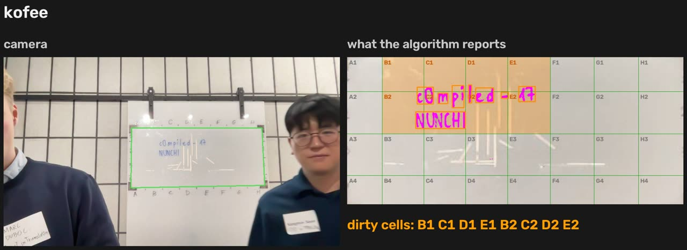
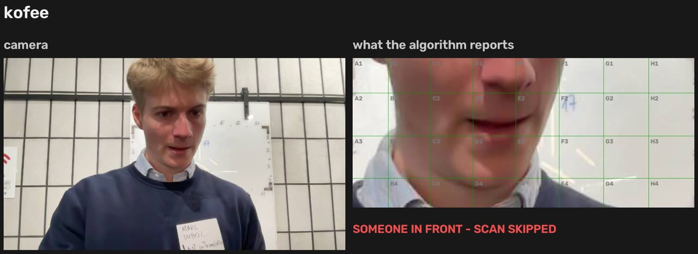
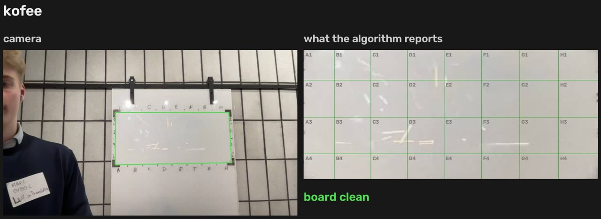
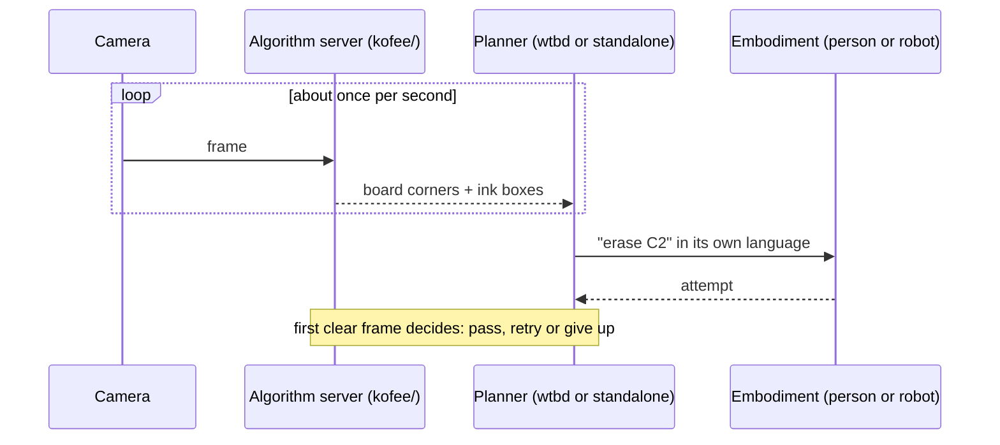

# NUNCHI

**One task interface for any embodiment, and a camera that checks the result: the two things a robot data flywheel needs.**

Built in five hours at [c0mpiled-17 Seoul](https://luma.com/compiled-8lsr), track *New Operating Systems for the Physical World*. Code name `kofee`.



## Why

Tesla keeps retraining its self-driving model on data from its own cars: a data flywheel. Robots don't have one, for two reasons:

1. **Every robot speaks its own action language**, so tasks and data don't transfer from one body to another.
2. **Someone has to check every attempt** to say whether it worked.

## What it does

A glass whiteboard must be kept clean, and a camera watches it. Anything written in **blue** is dirt.

- **One task, any body.** A dirty cell becomes a task written only in board coordinates, with its own success test (`erase C2`, ink < 0.25 %). Each embodiment gets it in its own language: *"Marc, erase cell C2."* spoken to a person, `arm.wipe(x=…mm, y=…mm, passes=…)` for a robot arm.
- **No human checks.** Nobody reports success. The first clear frame after the attempt decides: pass, or retry handed to the next embodiment (up to 3 attempts).
- **Every attempt is a labeled episode.** Who did it, how long it took, before/after crops and the verdict go to `runs/<session>/episodes.jsonl`.

We had no robots at the hackathon, so we were the robots: two people, two tools (eraser, tissue), the same tasks.

| Someone at the board: the scan is skipped | First clear frame: verified |
| --- | --- |
|  |  |

## How it works

Per frame, stateless, about 30 ms for a 960 px frame on a laptop CPU ([`kofee/analyze.py`](kofee/analyze.py)):

1. **Frame**: find the four black L tape marks. A hidden mark, or a quadrilateral that disagrees with the marks' arms, makes the frame unusable.
2. **Rectify** to a top-down view with the homography of the four elbows.
3. **Occlusion guard**: a large dark region is a person or an eraser, so the scan is skipped and no task is judged through a sweater.
4. **Ink**: darker than its local background, ceiling-light reflections and glare streaks clipped, specks under 40 px ignored. Colour is decided per stroke, so the black frame, ticks and labels are never dirt.
5. **Cells**: one tight box per blob, mapped onto the hand-drawn 8 × 4 grid (`A1` … `H4`, measured in [`grid.json`](grid.json)).



## Run it

```bash
uv sync
uv run kofee-standalone --agents Marc:eraser,Kangmin:tissue   # the demo: webcam, planner, voice, episode log
uv run pytest                                                  # tests on synthetic frames
```

Full stack with the phone app ([Akan.js](https://github.com/akan-team/akanjs) on Bun):

```bash
uv run kofee --grid grid.json                                  # algorithm server, prints VISION_API_URL
bun install && VISION_API_URL=http://<host>:8000 bun run dev   # app server: Monitor and Eraser pages
```

After redrawing the grid ticks, measure them again from a clear photo: `uv run kofee-grid photo.jpg`.

| Path | Role |
| --- | --- |
| [`kofee/`](kofee/) | Vision: L marks, rectification, occlusion guard, ink, grid |
| [`kofee/standalone/`](kofee/standalone/) | All-in-one demo: task interface, planner, verifier, episode log ([API](docs/standalone-api.md)) |
| [`apps/wtbd/`](apps/wtbd/) | App server, Monitor and Eraser pages |
| [`protocol/`](protocol/algorithm-server.md) | Contract between the app server and the algorithm server |

Team: [promaaa](https://github.com/promaaa) and [aka-bassman](https://github.com/aka-bassman).
