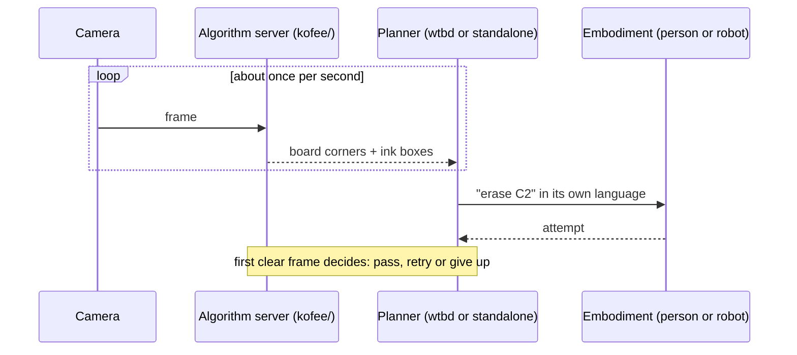

<div align="center">

<a href="https://luma.com/compiled-8lsr"></a>
&nbsp;&nbsp;&nbsp;&nbsp;
<a href="https://www.ycombinator.com/rfs"></a>

# NUNCHI

**The data flywheel for robots.<br/>One task interface for any embodiment, and a camera that labels every attempt.**

Built in five hours at **c0mpiled-17 Seoul** (9 November 2026) on the Y Combinator Request for Startups topic<br/>*New Operating System for the Physical World*.

[](https://luma.com/compiled-8lsr)
[](https://www.ycombinator.com/rfs)
[](#quick-start)
[](kofee/analyze.py)
[](apps/wtbd/)
[](https://youtu.be/Qo3HoJxw4Gs)

<a href="https://youtu.be/Qo3HoJxw4Gs"></a>

<sub>The camera view during the demo. Click on the gif to watch the 80-second hackathon video.</sub>

</div>

## The problem

Tesla keeps retraining its driving model on the data its cars collect. That loop is a **data flywheel**. Robotics companies want the same loop, but two things block it:


1. **Every robot speaks its own action language.** Joint angles for an arm, `v, ω` for a mobile base, PWM for a dog. A task written for one body does not transfer to another.
2. **A person must label every attempt.** Somebody has to watch and say whether it worked, so data collection stops when that person stops.

NUNCHI (눈치, *knowing just by watching*) removes both blocks on a real task: keep a glass whiteboard clean.

<br clear="right"/>

## Highlights

- **One task, any body.** The camera turns ink into dirty cells (`A1` … `H4`). Each cell becomes one task in board coordinates, with its own success test: ink under 0.25 % of the cell. The planner translates it for each embodiment.
- **The camera is the judge.** Nobody reports success. The first clear frame after the attempt decides: pass, or retry, handed to the next embodiment (up to 3 attempts).
- **Every attempt is a labelled episode.** Who did it, with which tool, how long it took, before and after crops, and the verdict go to `runs/<session>/episodes.jsonl`.
- **Fast and stateless.** One frame takes about 30 ms on a laptop CPU, at 960 px. No training data, no GPU.

## One task, two languages

The task is written once, in board coordinates. The planner then states it for each embodiment:

```text
task    erase C2          success: ink_ratio < 0.25%
human   "Marc, erase cell C2."
robot   arm.wipe(x=251..387mm, y=117..260mm, passes=3)
```

## Live demo

We had no robots at the hackathon, so we were the robots: two people, two tools (an eraser and a tissue), the same tasks.

<table>
  <tr>
    <td width="33%" align="center" valign="top">
      
      <br/><sub><b>1. Detect.</b> The camera finds ink in B2, C2, D1 and D2. C2 becomes the task.</sub>
    </td>
    <td width="33%" align="center" valign="top">
      
      <br/><sub><b>2. Attempt.</b> Marc erases. The scan is skipped while he is in front of the board.</sub>
    </td>
    <td width="33%" align="center" valign="top">
      
      <br/><sub><b>3. Verify.</b> The first clear frame shows a clean grid. C2 passes.</sub>
    </td>
  </tr>
</table>

The episode log of this run, as shown in the video. The camera wrote every label:

| Episode | Agent | Tool | Task | What the camera saw | Verdict |
|:-:|---|---|---|---|:-:|
| 1 | Marc | eraser | erase C2 | ink left | fail |
| 2 | Marc | eraser | erase C2 | ink left | fail |
| 3 | Marc | eraser | erase C2 | clean cell | pass |

## How it works

<div align="center">

<br/><sub>What the algorithm reports: the rectified board, ink boxes in pink, dirty cells B1 to E2 in orange.</sub>
</div>
<br/>

Each frame is analysed on its own, with no state ([`kofee/analyze.py`](kofee/analyze.py)):

1. **Find the board.** Four black L tape marks frame it. When a mark is hidden, or the quadrilateral disagrees with the arms of the marks, the frame is rejected.
2. **Rectify** the board to a top-down view with the homography of the four corners.
3. **Skip occluded frames.** A large dark region is a person or an eraser, so the scan is skipped. No task is judged through a sweater.
4. **Find the ink.** A pixel is ink when it is darker than its local background. Ceiling-light reflections and glare streaks are clipped, and specks under 40 px are ignored. Colour is decided per stroke, so the black frame, ticks and labels are never dirt.
5. **Map to cells.** Each blob gets one tight box, mapped onto the hand-drawn 8 × 4 grid measured in [`grid.json`](grid.json).



## Quick start

```bash
git clone https://github.com/promaaa/nunchi.git && cd nunchi
uv sync
uv run kofee-standalone --agents Marc:eraser,Kangmin:tissue   # webcam, planner, voice, episode log
uv run pytest                                                  # tests on synthetic and real frames
```

<details>
<summary><b>Full stack with the phone app</b> (<a href="https://github.com/akan-team/akanjs">Akan.js</a> on Bun)</summary>

```bash
uv run kofee --grid grid.json                                  # algorithm server, prints VISION_API_URL
bun install && VISION_API_URL=http://<host>:8000 bun run dev   # app server: Monitor and Eraser pages
```

After you redraw the grid ticks, measure them again from a clear photo: `uv run kofee-grid photo.jpg`.

</details>

## Repository

| Path | Role |
|---|---|
| [`kofee/`](kofee/) | Vision: L marks, rectification, occlusion guard, ink, grid |
| [`kofee/standalone/`](kofee/standalone/) | All-in-one demo: task interface, planner, verifier, episode log ([API](docs/standalone-api.md)) |
| [`apps/wtbd/`](apps/wtbd/) | App server, Monitor and Eraser pages |
| [`protocol/`](protocol/algorithm-server.md) | Contract between the app server and the algorithm server |
| [`tests/`](tests/) | Protocol, standalone and real-frame tests |

## Team

- **Marc Duboc** ([@promaaa](https://github.com/promaaa)): vision, planner, verifier.
- **Kangmin** ([@aka-bassman](https://github.com/aka-bassman)): app server, Monitor and Eraser pages.

Built at [c0mpiled-17 Seoul](https://luma.com/compiled-8lsr), COEX Startup Branch, organised by Transpose Platform. The challenge topic comes from the [Y Combinator Request for Startups](https://www.ycombinator.com/rfs). The project code name is `kofee`.
