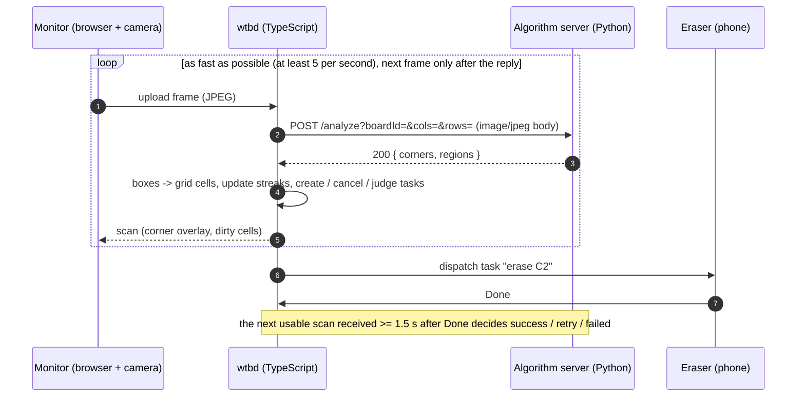

# Algorithm Server Protocol (v1)

Status: **draft v1**, written against the wtbd client as implemented in
`apps/wtbd/srvkit/remoteVisionApi.ts`. Anything marked **Proposed** is not implemented by wtbd yet; the full list is
in [section 12](#12-open-questions--proposed-changes).

## 1. Purpose, scope and roles

This document is the spec for the Python **algorithm server**: it receives one JPEG of a whiteboard and reports
where the board is in the frame and where the dirt (ink) is on the board. It covers only the HTTP contract between
the algorithm server and the TypeScript app server **wtbd**, plus practical guidance for building the algorithm.

| Role | What it is | Talks to |
|---|---|---|
| Human | Writes on the whiteboard. No software. | nobody |
| Monitor | Browser page with a camera aimed at the board. Uploads JPEGs back to back, one in flight, as fast as the camera and the pipeline allow. | wtbd |
| wtbd | App server (Akan.js on Bun, TypeScript). Turns dirt into erase tasks on a grid of cells. | Monitor, Eraser, algorithm |
| Eraser | A person acting as a robot, with a phone that shows which cell to erase. | wtbd |
| Algorithm server | **You.** Python, stateless, one endpoint. | answers wtbd only |



## 2. Data flow

| What | Direction | Typical size | Rate |
|---|---|---|---|
| Camera frame (JPEG, ~960 px wide, quality ~0.7) | Monitor -> wtbd | 60-120 KB | 5-60 per second per board |
| The same bytes, unchanged (no resize, re-encode or rotation) | wtbd -> algorithm | 60-120 KB | at most 1 in flight per board |
| JSON result | algorithm -> wtbd | under 2 KB (4 corners + a few dozen boxes) | 1 per request |

About 1 Mbit/s per board, LAN only. The Monitor waits for each reply before sending the next frame, so your latency
adds directly to the loop period.

What wtbd does with your answer, so you know which errors matter:

- **Unusable scan** (no 4 corners, error, timeout): nothing is created, cancelled or judged.
- **Creating a task**: a cell must be reported dirty by **3 usable scans in a row**. One false positive costs nothing.
- **Cancelling a pending task**: the cell must read clean in 3 usable scans in a row.
- **Judging after Done**: decided by **one** usable scan, the first wtbd received at least 1.5 s after Done.
  Dirty: retry, up to 3 attempts, then failed. Clean: succeeded. A miss on that frame reports a false success, and
  a false positive causes a retry. Accuracy on a clean, unobstructed frame matters most.
- **Unknown cells** (`unknown` mask, e.g. glare): never dirty in that scan, their streaks hold, and a task waiting
  for its verdict there is not judged until a later scan can see the cell. When unsure, mark it unknown rather than
  clean: unknown only delays a verdict, a wrong clean reports a false success.
- wtbd stamps each frame's time when it arrives, before calling you, so slow analysis never moves a frame to the
  wrong side of a Done report.

## 3. Protocol choice

Synchronous **HTTP/1.1 request/response**, raw JPEG as the request body, JSON response.

- One frame in, one result out, at most one request in flight per board: plain request/response fits exactly.
- Trivial to test with `curl`, trivial to stub, and works with FastAPI/Flask with no extra dependencies.
- **Not WebSocket**: needs connection state and reconnect logic, and gains little: a keep-alive HTTP round
  trip through wtbd and the server measured about 17 ms, so the loop is bound by your latency, not the transport.
- **Not gRPC**: needs `.proto` code generation and an HTTP/2 stack on both sides for a single call.
- **Not multipart/form-data**: one image needs no boundaries. The metadata fits in the query string, and FastAPI's
  `UploadFile` would also need `python-multipart`.
- **Not base64-in-JSON**: makes the frame 33% larger and adds an encode and decode step.

## 4. Endpoints

### 4.1 `POST /analyze`

```
POST {VISION_API_URL}/analyze?boardId=main&cols=8&rows=4
Content-Type: image/jpeg

<raw JPEG bytes>
```

| Query param | Type | Always sent | Meaning |
|---|---|---|---|
| `boardId` | string | yes | Always `main`: wtbd watches exactly one board. Kept so servers built against earlier drafts keep working; use it only for logs. |
| `cols` | int >= 1 | yes | Grid columns (default 8). **Hint only.** Never needed: wtbd maps boxes to cells itself. |
| `rows` | int >= 1 | yes | Grid rows (default 4). Hint only. |

**Headers**: `Content-Type: image/jpeg` (`Content-Length` is set automatically) and `X-Protocol-Version: 1`. No
auth: LAN-only prototype.

**Body**: the raw JPEG exactly as the Monitor captured it. Read the size from the decoded image: width is about
960 px, but the height depends on the camera (e.g. 540 or 720).

**Response**: `200`, `Content-Type: application/json`.

```json
{
  "corners": [[0.060, 0.100], [0.940, 0.091], [0.950, 0.900], [0.050, 0.909]],
  "regions": [{ "x": 0.27, "y": 0.30, "w": 0.08, "h": 0.15, "score": 0.91 }],
  "unknown": [{ "x": 0.12, "y": 0.00, "w": 0.15, "h": 0.20 }]
}
```

Board not found (a person in front of it, camera moved, a mark hidden). This is still a `200`, not an error:

```json
{ "corners": null, "regions": [] }
```

| Field | Type | Meaning | How wtbd reads it today |
|---|---|---|---|
| `corners` | 4 x `[x, y]` or `null` | Inner elbows of the L marks, as **frame** fractions, order TL, TR, BR, BL | Missing or `null` means unusable. Anything other than exactly 4 points means unusable. |
| `regions` | array | Dirt boxes as **board** fractions (section 5) | Missing means `[]` |
| `regions[].x`, `.y` | number, 0-1 | Top-left of the box | Clamped to the grid when mapping |
| `regions[].w`, `.h` | number, 0-1 | Box size | Same |
| `regions[].score` | number, 0-1, optional | Confidence | Boxes with `score < 0.5` are dropped. Missing or `null` counts as 1. |
| `unknown` | array, optional | Areas you cannot read (glare, occlusion), as **board** fractions `{x, y, w, h}` | Missing means `[]`. Every cell a box touches is unknown for this scan, and unknown wins over dirt. |
| any other key | anything | | Ignored |

When `corners` is `null`, send `regions: []`. Regions only make sense relative to a board that was found.

JSON Schema (draft 2020-12). It describes what you should send, which is slightly stricter than what wtbd tolerates:

```json
{
  "$schema": "https://json-schema.org/draft/2020-12/schema",
  "title": "AnalyzeResponse",
  "type": "object",
  "required": ["corners", "regions"],
  "$defs": {
    "fraction": { "type": "number", "minimum": 0, "maximum": 1 },
    "point": {
      "type": "array",
      "prefixItems": [{ "$ref": "#/$defs/fraction" }, { "$ref": "#/$defs/fraction" }],
      "minItems": 2,
      "items": false
    },
    "region": {
      "type": "object",
      "required": ["x", "y", "w", "h"],
      "properties": {
        "x": { "$ref": "#/$defs/fraction" },
        "y": { "$ref": "#/$defs/fraction" },
        "w": { "$ref": "#/$defs/fraction" },
        "h": { "$ref": "#/$defs/fraction" },
        "score": { "anyOf": [{ "$ref": "#/$defs/fraction" }, { "type": "null" }] }
      }
    },
    "rect": {
      "type": "object",
      "required": ["x", "y", "w", "h"],
      "properties": {
        "x": { "$ref": "#/$defs/fraction" },
        "y": { "$ref": "#/$defs/fraction" },
        "w": { "$ref": "#/$defs/fraction" },
        "h": { "$ref": "#/$defs/fraction" }
      }
    }
  },
  "properties": {
    "corners": {
      "oneOf": [
        { "type": "null" },
        { "type": "array", "items": { "$ref": "#/$defs/point" }, "minItems": 4, "maxItems": 4 }
      ]
    },
    "regions": { "type": "array", "items": { "$ref": "#/$defs/region" } },
    "unknown": { "type": "array", "items": { "$ref": "#/$defs/rect" } }
  }
}
```

Pydantic v2 (Python side):

```python
from typing import Annotated

from pydantic import BaseModel, Field

Fraction = Annotated[float, Field(ge=0.0, le=1.0)]
Point = tuple[Fraction, Fraction]


class Rect(BaseModel):
    x: Fraction
    y: Fraction
    w: Fraction
    h: Fraction


class Region(Rect):
    score: Fraction | None = None


class AnalyzeResponse(BaseModel):
    corners: tuple[Point, Point, Point, Point] | None
    regions: list[Region] = Field(default_factory=list)
    unknown: list[Rect] = Field(default_factory=list)
```

TypeScript (wtbd side, verbatim from `remoteVisionApi.ts`):

```ts
interface AnalyzeResponse {
  corners?: [number, number][] | null;
  regions?: (VisionRect & { score?: number })[];
  unknown?: VisionRect[];
}
```

### 4.2 `GET /health`

```
GET /health  ->  200 {"status": "ok", "version": "0.1.0"}
```

wtbd calls it once at startup when `VISION_API_URL` is set and logs a warning when it fails or answers non-2xx. It
never blocks boot: frames simply scan as unusable until the server answers.

## 5. Coordinate systems

There are two spaces. **Corners use frame space, regions use board space.** Neither uses pixels.

**Frame space** (`corners`): fractions of the received JPEG, `x = px / width`, `y = py / height`, origin at the
top-left of the image, y pointing down. Order is **TL, TR, BR, BL** (clockwise), as the marks appear in the JPEG.
wtbd uses corners only to decide usability and forwards them to the Monitor for an overlay. It never re-warps
anything, so the perspective correction is entirely yours.

```
 (0,0)                                                          (1,0)
   +--------------------------------------------------------------+
   |                                                              |
   |  ########                                          ########  |
   |  ##* TL (0.060, 0.100)                TR (0.940, 0.091) *##  |
   |  ##                                                      ##  |
   |                                                              |
   |                  board, seen in perspective                  |
   |                                                              |
   |  ##                                                      ##  |
   |  ##* BL (0.050, 0.909)                BR (0.950, 0.900) *##  |
   |  ########                                          ########  |
   |                                                              |
   +--------------------------------------------------------------+
 (0,1)                                                          (1,1)
```

**The inner elbow** is the concave corner of each L: where the inner edge of one arm meets the inner edge of the
other. Close-up of the top-left mark (`#` is tape):

```
  ##########
  ##########
  ###*---------  y = 0 (top edge of board space)
  ###|
  ###|  x = 0 (left edge of board space)
```

**Board space** (`regions`): the straightened quadrilateral whose corners are the four inner elbows, scaled to
0-1 on both axes. The origin is the TL inner elbow, x grows right, y grows down. The tape lies **outside** the
0-1 square, so it can never read as dirt. wtbd lays its grid over this square:

```
    x=0           0.25          0.5           0.75          x=1
  ########                                             ########
  ##*------+------+------+------+------+------+------+------*##     y=0
  ##|  A1  |  B1  |  C1  |  D1  |  E1  |  F1  |  G1  |  H1  |##
    +------+------+------+------+------+------+------+------+       y=0.25
    |  A2  |  B2  |[ C2 ]|  D2  |  E2  |  F2  |  G2  |  H2  |
    +------+------+------+------+------+------+------+------+       y=0.5
    |  A3  |  B3  |  C3  |  D3  |  E3  |  F3  |  G3  |  H3  |
    +------+------+------+------+------+------+------+------+       y=0.75
  ##|  A4  |  B4  |  C4  |  D4  |  E4  |  F4  |  G4  |  H4  |##
  ##*------+------+------+------+------+------+------+------*##     y=1
  ########                                             ########
```

Cells are numbered `cell = row * cols + col` (0-based) and labelled with the column letter, then the row number
starting at 1. `C2` is col 2, row 1, so cell `10`, covering x 0.250-0.375 and y 0.25-0.50.

### Worked example: dirt in C2 on an 8 x 4 grid

A 960 x 540 frame. The inner elbows are at pixels TL (58, 54), TR (902, 49), BR (912, 486) and BL (48, 491). You
warp the board to 1000 x 500 px and find one word at warped pixels x 270-350, y 150-225. Response:

```json
{
  "corners": [[0.060, 0.100], [0.940, 0.091], [0.950, 0.900], [0.050, 0.909]],
  "regions": [{ "x": 0.27, "y": 0.30, "w": 0.08, "h": 0.15, "score": 0.91 }]
}
```

wtbd's `cellsCoveredBy` (`apps/wtbd/lib/board/board.constant.ts`) computes, for `cols = 8, rows = 4`:

```
left   = max(0,      floor(x * cols))           = floor(2.16)     = 2
right  = min(cols-1, ceil((x + w) * cols) - 1)  = ceil(2.80) - 1  = 2
top    = max(0,      floor(y * rows))           = floor(1.20)     = 1
bottom = min(rows-1, ceil((y + h) * rows) - 1)  = ceil(1.80) - 1  = 1
cells  = { row * 8 + col }                      = { 10 }          -> "C2"
```

Edge cases under the same rule:

| Region (`x, y, w, h`) | Cells | Why |
|---|---|---|
| `0.37, 0.30, 0.01, 0.10` | C2, D2 | Any overlap counts, even a sliver across x = 0.375 |
| `0.25, 0.25, 0.125, 0.25` | C2 | An edge that lies exactly on a boundary does not spill over |
| `-0.02, 0.30, 0.06, 0.10` | A2 | Partly outside: clamped |
| `1.05, 0.30, 0.05, 0.10` | none | Entirely outside: ignored |
| `0.10, 0.30, 0.80, 0.10` | A2 ... H2 | One box over two distant words tasks the whole row |
| any box with `score: 0.3` | none | Dropped before mapping |

So: **return tight boxes, one per blob or word, and do not pad them.** Padding spills into neighbouring cells, and
one union box covers every cell in between.

## 6. Error handling and timeouts

wtbd checks only `response.ok` (status 200-299) and then parses JSON. Every failure becomes an **unusable scan**
for that frame. wtbd never retries a frame, because the next one arrives about 1 s later.

| Situation | Algorithm server returns | wtbd does |
|---|---|---|
| Image decoded, all 4 marks found | `200` with corners + regions | Usable scan |
| Image decoded, a mark missing or the board blocked | `200` with `{"corners": null, "regions": []}` | Unusable scan, no error logged |
| Empty body, not a JPEG, `imdecode` returns `None` | `400 {"detail": "..."}` | Logs `Vision server answered 400 for board <id>`, unusable |
| Missing or invalid query params | `422` (FastAPI default) | Same, with 422 |
| Body unreasonably large (optional, e.g. > 5 MB) | `413` | Same, with 413 |
| Unexpected exception | `500` | Same, with 500 |
| No reply within **3 s** | (wtbd aborts the request) | Logs `Vision server unreachable ... TimeoutError`, unusable |
| Connection refused, DNS failure | | Logs `Vision server unreachable ...`, unusable |
| `200` whose body is not valid JSON | | Logged as "unreachable" with the parse error, unusable |

Rules for the Python side:

- A board that cannot be seen is a **result**, not an error: answer `200` with `corners: null`.
- Never queue or block waiting for something. If you cannot answer within 3 s, the work is wasted.
- Validate your output with the Pydantic model. wtbd does not reject a malformed region (missing `x`, `NaN`); its
  behaviour on one is undefined.

## 7. Performance budget and state

| Item | Budget |
|---|---|
| Target latency per frame (server-side, p95) | **< 500 ms**. A plain OpenCV pipeline at 960 px usually runs in tens of ms. |
| Hard limit | **3 s**. wtbd aborts the request and the frame is unusable. |
| Concurrency | at most 1 request per board in flight; different boards may overlap |

The Monitor sends the next camera frame as soon as the previous reply lands (it encodes the next frame while it
waits), so your latency sets the detection rate: 200 ms is the 5 fps floor, and every millisecond saved is a
higher rate. At 960 x 540 the current server answers in about 16 ms, about 60 fps. Per-frame work that only feeds
`/debug/board.jpg` (annotate, encode, print) is part of that budget.

**Statelessness.** Each request must be answerable from its own bytes. wtbd restarts, dropped frames and a Python
restart must never change results. Per-board state keyed by `boardId` is optional and may only make things faster,
for example remembering where the marks were last time to narrow the search. In particular, **never reuse
previous corners when a mark is not visible in this frame.** wtbd relies on `corners: null` to skip frames in which
someone is standing in front of the board. Temporal smoothing is unnecessary: wtbd already requires 3 agreeing
scans before it creates or cancels a task.

Load models and allocate kernels once at startup, not per request. If you use `async def`, run the OpenCV work
with `await starlette.concurrency.run_in_threadpool(fn, frame)` so `/health` stays responsive.

## 8. Algorithm guidance (OpenCV)

The board is cream-white and glossy. Four dark gray L-shaped tape marks sit at the corners, elbows pointing
outward. Expect **strong ceiling-light glare spots** near the top and **streaky reflections along the bottom edge**.
Both are bright, not dark, but they can hide ink.

1. **Decode**: `img = cv2.imdecode(np.frombuffer(body, np.uint8), cv2.IMREAD_COLOR)`. If it is `None`, answer 400.
2. **Find the L marks.** Tape is dark and unsaturated. In HSV, start with `V < ~110` and `S < ~60`, tune on a real
   frame, then apply a small `MORPH_OPEN`. Run `cv2.findContours(..., RETR_EXTERNAL, ...)` and keep contours with
   area roughly 0.05-2% of the frame and solidity (`area / hull area`) about 0.3-0.75. An L fills about half its
   hull; a person, a marker or a shadow does not.
3. **Assign corners**: take one candidate per quadrant, the largest if there are several. Alternatively sort by
   `x + y` (TL is smallest, BR largest) and `y - x` (TR smallest, BL largest). **Any quadrant empty: `corners: null`.**
4. **Inner elbow**: take the deepest point from `cv2.convexityDefects(contour, cv2.convexHull(contour,
   returnPoints=False))`. It is exactly the concave corner of the L. Optionally refine with `cv2.cornerSubPix`.
   Do not use "the vertex closest to the board centre": an arm's inner tip can be closer than the elbow.
5. **Sanity-check the quad**: it must be convex, cover more than ~20% of the frame, and have opposite sides within
   ~30% of each other in length. Otherwise return `null`.
6. **Warp**: `M = cv2.getPerspectiveTransform(elbows_px, [(0,0), (W,0), (W,H), (0,H)])`, then
   `cv2.warpPerspective`. Use roughly the board's aspect ratio (the L marks enclose about 112 x 49 cm, so e.g.
   W x H = 960 x 420). A warped pixel `(u, v)` is board fraction `(u / W, v / H)`.
7. **Ink = darker than the local background.** Use `gray = img.min(axis=2)`, so red, blue and green markers all
   look dark on white. Then either
   `cv2.adaptiveThreshold(gray, 255, cv2.ADAPTIVE_THRESH_GAUSSIAN_C, cv2.THRESH_BINARY_INV, 51, 15)` (block size
   about 5% of W, odd; a higher `C` ignores faint ghosting) or the more glare-robust black-hat:
   `cv2.morphologyEx(gray, cv2.MORPH_BLACKHAT, ellipse_25x25) > 25`.
8. **Glare**: `glare = dilate((V > 240) & (S < 40), 15x15)`, then remove it from the ink mask. Glare is never ink,
   but halo edges and the bottom streaks can trip a threshold. Ink under glare is invisible and v1 has no way to say
   "unknown", so it reads as clean (see section 12).
9. **Mask the border**: zero about 3% inside each edge of the warped image (tape edges, frame shadow, bottom-edge
   reflections).
10. **Boxes**: apply `MORPH_OPEN` 3x3 to remove speckle, then dilate by ~1-2% of W to join the letters of a word.
    Run `cv2.connectedComponentsWithStats` and drop components smaller than ~0.02% of the board area. Use each
    component's bounding box, shrunk back by the dilation. `score` is optional, e.g. mean darkness or ink-pixel
    density scaled to 0-1.
11. **Occlusion guard (recommended)**: if ink covers more than ~25% of the board, someone is probably standing in
    front of it. Return `corners: null` rather than reporting a person as dirt.

Debug tip: when an env var such as `DEBUG_DIR` is set, write the warped image and the final mask for each request.
Tuning thresholds is much faster with pictures.

## 9. Minimal FastAPI stub

Satisfies the contract with fake data. It always reports C2 dirty on an 8 x 4 grid.

```python
# algo_stub.py: fake algorithm server for protocol v1 (no image analysis).
#   pip install "fastapi>=0.110" "uvicorn[standard]" "pydantic>=2"
#   uvicorn algo_stub:app --host 0.0.0.0 --port 8000
from typing import Annotated

from fastapi import FastAPI, HTTPException, Query, Request
from pydantic import BaseModel, Field

Fraction = Annotated[float, Field(ge=0.0, le=1.0)]
Point = tuple[Fraction, Fraction]


class Rect(BaseModel):
    x: Fraction
    y: Fraction
    w: Fraction
    h: Fraction


class Region(Rect):
    score: Fraction | None = None


class AnalyzeResponse(BaseModel):
    corners: tuple[Point, Point, Point, Point] | None
    regions: list[Region] = Field(default_factory=list)
    unknown: list[Rect] = Field(default_factory=list)


app = FastAPI()
FAKE_CORNERS = ((0.060, 0.100), (0.940, 0.091), (0.950, 0.900), (0.050, 0.909))
FAKE_DIRT = [Region(x=0.27, y=0.30, w=0.08, h=0.15, score=0.91)]


@app.get("/health")
def health() -> dict[str, str]:
    return {"status": "ok", "version": "stub-0.1"}


@app.post("/analyze", response_model=AnalyzeResponse)
async def analyze(
    request: Request,
    board_id: Annotated[str, Query(alias="boardId", min_length=1)],
    cols: Annotated[int, Query(ge=1)] = 8,
    rows: Annotated[int, Query(ge=1)] = 4,
) -> AnalyzeResponse:
    frame = await request.body()
    if not frame.startswith(b"\xff\xd8\xff"):
        raise HTTPException(status_code=400, detail="body is not a JPEG")
    return AnalyzeResponse(corners=FAKE_CORNERS, regions=FAKE_DIRT)
```

In wtbd, this stub makes C2 a task once it has read dirty for 1 s (`BoardGrid.stableMs`) and dispatches it. Because the stub never cleans C2, each Done
leads to a retry, the task fails after 3 attempts, and C2 is not tasked again for 60 s. Set `FAKE_DIRT = []` to see
a task succeed. FastAPI's interactive docs are at `http://localhost:8000/docs`.

Test with `curl`. Make a test JPEG first, e.g. `sips -Z 960 -s format jpeg photo.png --out board.jpg` on macOS.
Always use `--data-binary`; `-d` mangles binary data.

```bash
curl -s http://localhost:8000/health

curl -s -X POST 'http://localhost:8000/analyze?boardId=test&cols=8&rows=4' \
  -H 'Content-Type: image/jpeg' --data-binary @board.jpg | python3 -m json.tool

# status and latency only
curl -s -o /dev/null -w '%{http_code} %{time_total}s\n' -X POST \
  'http://localhost:8000/analyze?boardId=test&cols=8&rows=4' \
  -H 'Content-Type: image/jpeg' --data-binary @board.jpg

# error paths: expect 400, then 422
curl -s -i -X POST 'http://localhost:8000/analyze?boardId=test&cols=8&rows=4' \
  -H 'Content-Type: image/jpeg' --data-binary 'not a jpeg'
curl -s -i -X POST 'http://localhost:8000/analyze?boardId=test&cols=zero&rows=4' \
  -H 'Content-Type: image/jpeg' --data-binary @board.jpg
```

## 10. Pointing wtbd at the algorithm server

```bash
# repo root, in the shell that starts wtbd
VISION_API_URL=http://192.168.0.42:8000 bun run dev
```

- Give the **base URL only**: no trailing slash and no `/analyze`. wtbd appends `/analyze?...` itself, and a
  trailing slash produces `//analyze`, which returns 404.
- wtbd also accepts `visionApiUrl` in its server env options. The env var is used when that option is unset.
- Restart wtbd after changing it. When it is unset, wtbd uses its in-process mock.
- To confirm the wiring, check the scan wtbd returns to the Monitor: it carries `source: "remote"` (instead of
  `"mock"`) and `latencyMs`. Failures appear in the wtbd log as `Vision server answered <status> ...` or
  `Vision server unreachable ...`.

Networking:

- wtbd must be able to open a TCP connection to the algorithm server. The algorithm server never calls wtbd, and
  the Monitor and Eraser never talk to it.
- On another machine, run uvicorn with `--host 0.0.0.0`. `localhost` works only when both run on the same host
  and neither is in a container.
- Before starting wtbd, run `curl http://<host>:<port>/health` **from the wtbd machine**. Venue Wi-Fi often blocks
  device-to-device traffic (client isolation); a phone hotspot or wired LAN avoids that. Allow Python through the
  macOS firewall if prompted.
- There is no auth and no TLS: keep it on the LAN and never expose it to the internet.

## 11. Versioning

This document describes **v1**. wtbd sends `X-Protocol-Version: 1` on every `/analyze` call; it does not read a
version back yet.

- The algorithm server may echo it as a response header and/or add `"version": 1` to the JSON body; wtbd ignores
  unknown keys.
- These stay v1: new optional response fields and new optional query params. These require v2: changing coordinate
  meaning, corner order, required fields or status-code semantics. A server that cannot speak the requested
  version answers `400` with a `detail` message.

## 12. Open questions / proposed changes

### Open questions

- **Ghosting**: should faint residue left by a dry eraser count as dirt? The threshold (`C` or the black-hat cut)
  decides between endless retries and false successes. Agree on it using real frames.
- **Orientation**: we assume the JPEG arrives upright and not mirrored. Confirm with whoever builds the Monitor.
- **Glare cells**: resolved on the wtbd side by the `unknown` mask (item 6). The algorithm still has to detect glare
  and report it; a glare spot it misses still reads clean.
- **Eraser in frame at judge time**: if the marks are visible but the eraser's arm is still over the board, that
  frame can falsely judge "still dirty". The occlusion guard (section 8, step 11) is the cheap fix.

### Changes needed on the wtbd side

Items 1, 2 (sending only) and 6 are **done**; the rest do not exist yet. Additive response fields can be sent by
Python early (wtbd ignores unknown keys), but they have no effect until wtbd changes.

1. **Done.** **Call `GET /health`** at startup (and optionally periodically), and log a clear warning when the algorithm
   server is unreachable instead of failing frame by frame.
2. **Sending done, reading not.** **Send `X-Protocol-Version: 1`** on `/analyze`, and read the response `version` (header or body field), logging
   a mismatch.
3. **Read frame size from the response** (`"frame": {"width": 960, "height": 540}`) to sanity-check the corner
   overlay and log resolution or aspect problems.
4. **Pass the board's physical size as hints** (`&widthCm=112&heightCm=49`, `BoardGrid` in wtbd) so the
   algorithm can warp at the true aspect ratio.
5. **Per-region labels** (`"label": "ink" | "residue" | "other"`) plus a wtbd rule for which labels create tasks.
6. **Done.** **An unknown/glare mask** (`"unknown": [{x, y, w, h}]` in board space). Cells it covers are neither dirty nor
   clean for that scan: their streaks do not move, and a verifying task in such a cell waits for a later scan.
7. **A reason for unusable answers** (`"reason": "no_board" | "occluded" | ...` alongside `corners: null`), shown
   on the Monitor and in logs.
8. **Stricter response handling**: reject regions with missing or non-finite numbers and corners that are not
   2-number pairs in 0-1. Also log JSON parse errors separately from network errors (today both are logged as
   "Vision server unreachable").
